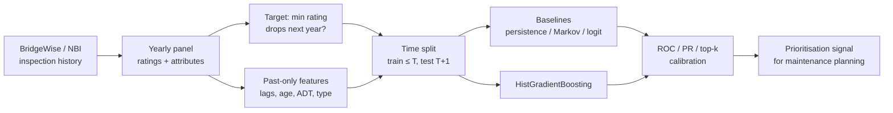
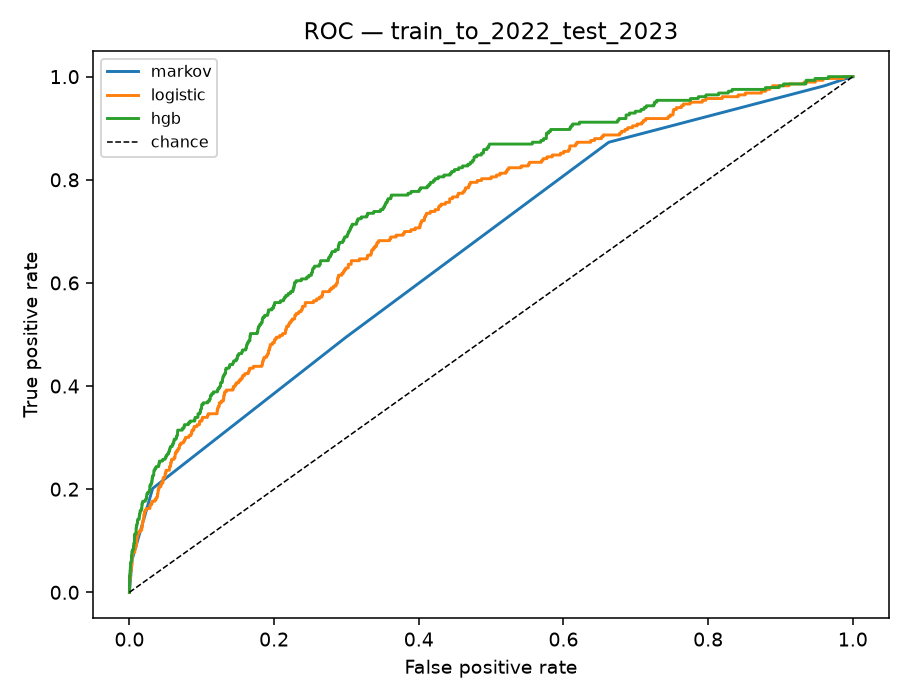
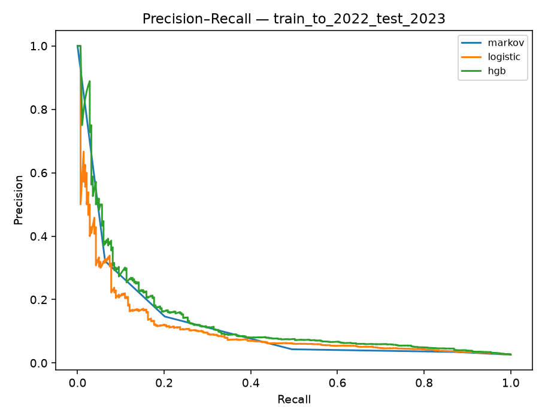
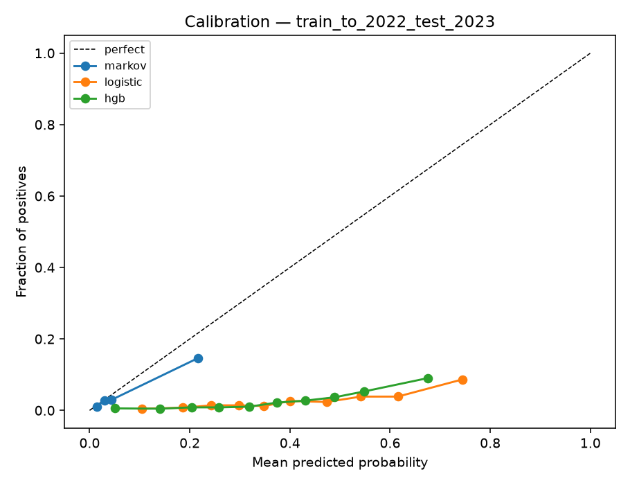

# Bridge condition deterioration prediction (NBI prototype)

**Methodological prototype** for a predictive-maintenance module intended to sit on top of an operational bridge inspection system (**BridgeWise**, ICT Organisation of Karaj Municipality).

This repository does **not** contain Karaj municipal data. It demonstrates, on the public **FHWA National Bridge Inventory (NBI)**, how multi-year inspection histories can be turned into a leakage-aware “will condition drop next year?” model. The same pipeline is designed to plug into BridgeWise once local inspection panels are research-ready.

| | |
| --- | --- |
| Intended host system | BridgeWise — map registry, scheduled inspections, tablet checklists, photo + geolocation evidence (Karaj Municipality) |
| This repo | Reproducible NBI study (Virginia, 2016–2025) |
| Status | Research prototype; not a production risk score |

---

## Why this exists (link to Karaj)

BridgeWise digitises **inspection and evidence**. The natural next layer is **prioritisation**: which bridges are more likely to lose condition before the next cycle?

Karaj operational records are still being consolidated for research use and are sensitive. Until they can be used under municipal rules, this NBI prototype:

1. Forces a clean **panel + time-split** design (no random row leakage).
2. Provides **baselines** so ML cannot look good by default.
3. Documents a **field mapping** from NBI items to BridgeWise-style fields (`docs/field_mapping.md`).
4. Ships a small **JSON scorer** (`src/predict_from_record.py`) as an integration sketch.

U.S. NBI ≠ Karaj bridges. Metrics here measure the **pipeline**, not transfer performance.



---

## Problem

At inventory year \(t\), predict whether the **minimum** of deck / superstructure / substructure ratings (NBI 58/59/60) falls by ≥ 1 at \(t+1\):

\[
y_t = \mathbf{1}\big[\min(D_t,S_t,U_t) - \min(D_{t+1},S_{t+1},U_{t+1}) \ge 1\big]
\]

Codes: `0`–`9`; `N` = not applicable → excluded from the primary target when any of 58–60 is `N`/missing at \(t\) or \(t+1\) (see `docs/missing_values.md`).

Drops are rare → **do not headline accuracy**. Primary metrics: **ROC-AUC**, **PR-AUC**, class balance, calibration; also top‑k precision/lift for ranking.

---

## Data

| Setting | Choice |
| --- | --- |
| Source | FHWA NBI yearly **comma-delimited** Coding Guide files (header row; quotechar `'`) |
| State | Virginia (`VA`, code `51`) |
| Years | **2016–2025** |
| Records | `RECORD_TYPE_005A == 1` |
| Bridge ID | `STATE_CODE_001` + `STRUCTURE_NUMBER_008` |

Column names were verified from downloaded headers. Raw files are **not** in git (`data/raw/` gitignored); run `python -m src.download_data`. **No synthetic data.**

Panel after processing (this run): **140,012** bridge-years, **14,841** bridges; primary target defined on **95,474** rows (**3.39%** positives). Most exclusions are culvert-like (`STRUCTURE_TYPE_043B == 19`, items 58–60 = `N`).

---

## Method

**Features (current + past only):** component and min ratings; min/component deltas over prior 1–3 **calendar** years (row `shift` gated by year gap); years since last min-rating change; bridge age; log(ADT); structure kind/type.

**Models**

1. Persistence — \(P(\mathrm{drop})=0\)
2. Markov — \(P(\mathrm{drop}\mid \text{current min rating})\) on training years only
3. Logistic regression — imputed/scaled + one-hot; `class_weight='balanced'`
4. **HistGradientBoosting** (sklearn) — main model; early stopping on a **training** validation fraction

**Evaluation**

- Time splits only: train feature-years ≤ 2022 → test **2023**; ≤ 2023 → test **2024**
- Test year = **feature** year; label is the drop into the following year
- Seeds `{42, 123, 456}` for stochastic fits (logistic is effectively deterministic here; HGB varies)
- Stated decision threshold for P/R tables: **0.10** (not tuned on test; poorly suited to balanced classifiers — see below)

Unit tests cover target construction and “no test feature year in training features” (`tests/`).

---

## Results (Virginia NBI run)

| Split | Model | ROC-AUC | PR-AUC | Precision@0.10 | Recall@0.10 |
| --- | --- | --- | --- | --- | --- |
| ≤2022 → 2023 | persistence | 0.500 | 0.027 | 0.000 | 0.000 |
| ≤2022 → 2023 | markov | 0.661 | 0.070 | 0.147 | 0.201 |
| ≤2022 → 2023 | logistic | 0.722 ± 0.000 | 0.106 ± 0.000 | 0.028 ± 0.000 | 0.993 ± 0.000 |
| ≤2022 → 2023 | **HGB** | **0.758 ± 0.003** | **0.135 ± 0.003** | 0.029 ± 0.001 | 0.981 ± 0.006 |
| ≤2023 → 2024 | persistence | 0.500 | 0.031 | 0.000 | 0.000 |
| ≤2023 → 2024 | markov | 0.618 | 0.073 | 0.126 | 0.154 |
| ≤2023 → 2024 | logistic | 0.712 ± 0.000 | 0.092 ± 0.000 | 0.032 ± 0.000 | 0.994 ± 0.000 |
| ≤2023 → 2024 | **HGB** | **0.742 ± 0.001** | **0.143 ± 0.003** | 0.033 ± 0.001 | 0.993 ± 0.002 |

Test positive rates: **2.67%** (2023), **3.06%** (2024).

**Takeaway:** HGB beats Markov on ROC-AUC and PR-AUC on both splits. Absolute PR-AUC stays modest (~0.13–0.14). With `class_weight='balanced'`, mean predicted probabilities (~0.35–0.40) far exceed the ~3% base rate, so **P/R at 0.10 are not useful operating points**; prefer ranking / top‑k / recalibration for deployment.

### Ranking (top‑k on 2023 test; base rate ≈ 2.67%)

| Model | Top 1% precision (lift) | Top 5% precision (lift) | Top 10% precision (lift) |
| --- | --- | --- | --- |
| Markov | 0.217 (8.1×) | 0.113 (4.2×) | 0.061 (2.3×) |
| Logistic | 0.226 (8.5×) | 0.113 (4.2×) | 0.087 (3.3×) |
| **HGB** | **0.292 (11.0×)** | **0.136 (5.1×)** | **0.090 (3.4×)** |

### Figures







(Second split figures: `results/figures/*_train_to_2023_test_2024.png`. Full dump: `results/metrics_full.json`.)

### Diagnostic: inspection carry-forward

Using `DATE_OF_INSPECT_090`, **46.4%** of consecutive inventory-year pairs keep the same inspection date. Among rows with a defined primary target, drop rate is **0.38%** when the date is unchanged vs **5.90%** when it changes. Inventory year ≠ always a new inspection — an important limitation of year-ahead NBI labels.

---

## BridgeWise integration sketch

- Field mapping (placeholders for municipal field names): [`docs/field_mapping.md`](docs/field_mapping.md)
- Score one bridge history JSON:  
  `python -m src.predict_from_record examples/bridge_history_example.json`

---

## Reproduce

```bash
python -m venv .venv
# Windows: .venv\Scripts\activate
python -m pip install -r requirements.txt
python run_all.py
```

Or: `download_data` → `pytest` → `train_eval` → `predict_from_record`.  
Pinned deps verified on **Python 3.14 / Win64**. Seeds: project `42`; eval `42, 123, 456`.

```
src/          download, load, panel, features, targets, splits, baselines, models, eval, predict
tests/        target + time-split checks
docs/         field mapping, missing-value policy
results/      committed metrics + figures from the reported run
data/raw/     gitignored — download via src/download_data.py
```

---

## Limitations (please read)

1. **Not Karaj data** — climate, materials, coding practice, and scales differ; retrain before operational use.
2. **Carry-forward / biennial inspections** dilute true one-year deterioration signal.
3. **Miscalibrated probabilities** under class weighting; threshold 0.10 is illustrative only.
4. **Train labels can use year \(T{+}1\) ratings** while the test set uses year \(T{+}1\) as *features* (standard one-step panel; stricter isolation would stop training one year earlier).
5. **No sensors, video, or rehab modelling** in this repo.
6. Association ≠ causation; scores are prioritisation signals, not work orders.

---

## Planned directions (not implemented here)

- Train/evaluate on BridgeWise panels when municipal research data are available.
- Vision-based **displacement / vibration** from video and shifts in **natural frequencies** as condition indicators (not “live load from deck bounce” without stiffness/calibration).
- Low-cost sensing and public SHM benchmarks as a later monitoring layer.

---

## Attribution

NBI data published by FHWA. Code: research prototype by Mehdi Gholami, for academic discussion of inspection → predictive maintenance workflows.
