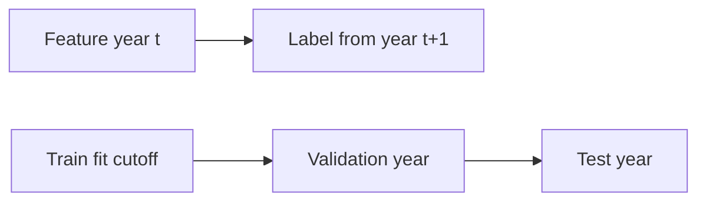

# Machine Learning-Based Bridge Deterioration Prediction for Predictive Maintenance

**A research prototype for extending the BridgeWise municipal inspection platform toward intelligent infrastructure monitoring.**

| Layer | Status |
| --- | --- |
| BridgeWise (Karaj Municipality) | Existing operational inspection / maintenance platform (not in this repository) |
| NBI machine-learning study | **Implemented** research prototype (this repository) |
| Sensing / vision / SHM extensions | **Proposed** future research only |

Author: Mehdi Gholami. Intended audience: academic review of methodology, reproducibility, and integration pathway.

---

## 1. Project overview

This repository investigates whether multi-year bridge condition ratings can support **maintenance prioritisation** via supervised learning. Experiments use the public FHWA National Bridge Inventory (NBI). The modelling pattern is designed to connect to **BridgeWise**, a municipal inspection system developed at the ICT Organisation of Karaj Municipality, once local research datasets are available under appropriate governance.

The contribution is **problem formulation, temporal data engineering, comparative evaluation, and an integration sketch**—not a claim of algorithmic novelty.

## 2. Research motivation and municipal context

BridgeWise digitises bridge registration, scheduled inspections, structured field assessment, photographic evidence with geolocation, and maintenance workflows. The natural analytical extension is to estimate which assets are more likely to lose condition before the next intervention cycle.

Municipal records are sensitive and still being prepared for research use. Until then, the NBI provides a public, multi-year panel for methodological development.

## 3. Research objectives

1. Construct a leakage-aware longitudinal panel from yearly NBI extracts.  
2. Define primary and alternative deterioration labels from component ratings.  
3. Compare transparent baselines with gradient boosting under chronological validation.  
4. Separate **ranking performance** from **probability calibration**.  
5. Document inspection carry-forward effects and a supplementary inspection-to-inspection analysis.  
6. Provide a conceptual BridgeWise field mapping and JSON scoring interface.

## 4. Dataset and preprocessing

| Setting | Value |
| --- | --- |
| Source | FHWA NBI yearly comma-delimited Coding Guide files |
| State | Virginia (`VA`, code `51`) |
| Years | 2016–2025 |
| Records | On-structure routes (`RECORD_TYPE_005A == 1`) |
| Bridge ID | `STATE_CODE_001` + `STRUCTURE_NUMBER_008` |

Column names are verified from file headers. Raw files are downloaded by `python -m src.download_data` and are not committed. Missing / `N` handling is documented in `docs/missing_values.md`. Culvert-like records (often type 19 with items 58–60 = `N`) dominate primary-target exclusions.

## 5. Prediction target

**Primary (retained):** decrease of at least one point in \(\min(\text{deck},\text{superstructure},\text{substructure})\) from year \(t\) to \(t+1\).

**Supplementary labels** (evaluated separately): any-component drop; deck-only; superstructure-only; substructure-only. These matter operationally because a deck drop may not change the minimum when another component is already lower.

## 6. Methodology

**Features (past/current only):** current ratings; calendar-gated 1–3 year deltas; years since last min-rating change; age; log ADT; structure kind/type. Bridge identifiers are never used as predictors.

**Models:** persistence; Markov transition baseline (training-only); logistic regression (unweighted and class-balanced); HistGradientBoosting (unweighted and class-balanced). Hyperparameter `max_iter` for HGB is selected by Average Precision on a **chronological validation year** (random early stopping disabled).

**Calibration:** sigmoid and isotonic calibrators fitted on validation scores only.

Details: `docs/temporal_validation.md`, `docs/field_mapping.md`.

## 7. Temporal validation strategy



Two protocols are reported:

- **Standard:** one-step panel with chronological train / validation / test (baseline continuity).  
- **Strict:** all training and validation **label observation years** precede the test **feature year**.

See `docs/temporal_validation.md` for exact cutoffs.

## 8. Experimental results

Executed results (Virginia NBI). Artifacts: `results/metrics_summary.csv`, `results/metrics_full.json`, `results/supplementary_results.json`, `results/inspection_study.json`, `results/figures/`.

**Primary target prevalence (test):** 2.67% (feature year 2023), 3.06% (2024).

### Standard protocol — test feature year 2023

| Model | ROC-AUC | Average Precision | Mean predicted p | Brier |
| --- | ---: | ---: | ---: | ---: |
| Markov | 0.661 | 0.070 | 0.036 | 0.025 |
| Logistic (unweighted) | 0.717 | 0.116 | 0.033 | 0.025 |
| Logistic (balanced) | 0.722 | 0.108 | **0.402** | 0.197 |
| HGB (unweighted) | **0.757** | **0.127** | 0.031 | 0.025 |
| HGB (balanced) | 0.751 | 0.121 | **0.342** | 0.155 |

After sigmoid calibration on the validation year, balanced HGB mean predicted probability falls to ≈0.029 (near prevalence). Ranking metrics are essentially unchanged by monotone calibration; Brier improves for balanced models.

**Top-k (HGB unweighted, 2023 test):** top 1% precision 0.283 (lift ≈10.6×); top 5% precision 0.134 (lift ≈5.0×).

### Strict protocol — test feature year 2023

HGB unweighted ROC-AUC **0.756**, AP **0.130**, mean predicted p **0.032** — comparable to the standard protocol, indicating that stricter label isolation does not erase the ranking signal in this setting.

### Carry-forward diagnostic

46.4% of consecutive inventory-year pairs reuse the same `DATE_OF_INSPECT_090`. Primary-target drop rate: **0.38%** (unchanged date) vs **5.90%** (changed date).

### Inspection-to-inspection study (supplementary)

Distinct inspection-date transitions: train n=30,107 (positive rate 6.8%); test n=11,416 (5.8%). HGB unweighted AP **0.182**, ROC-AUC **0.708** (higher positive rate than inventory-year task).

### Alternative targets (standard split, test 2024; HGB unweighted AP)

| Target | Test positive rate | HGB AP | Markov AP |
| --- | ---: | ---: | ---: |
| Any component drop | 7.25% | 0.199 | 0.087 |
| Deck drop | 3.38% | 0.189 | 0.049 |
| Superstructure drop | 3.51% | 0.163 | 0.054 |
| Substructure drop | 2.81% | 0.136 | 0.068 |

Deck-only deterioration is more predictable than the min-rating primary target in this sample; any-component labels are more prevalent.

### Feature ablation (standard, test 2024, unweighted HGB)

| Feature group | Test AP |
| --- | ---: |
| Current ratings only | 0.084 |
| Current + history | 0.105 |
| Structure/ops (+ cats) | 0.087 |
| All features | **0.140** |

**Interpretation guidelines**

- Headline ranking metrics: ROC-AUC and **Average Precision (AP)**.  
- Do not headline accuracy under ~3% positive prevalence.  
- Class-balanced models inflate mean predicted probabilities unless calibrated; uncalibrated outputs are **ranking scores**.  
- Prefer top‑k precision / lift for constrained inspection budgets.

## 9. Maintenance prioritisation implications

Municipal programmes inspect or intervene under capacity constraints. Top 1% / 5% / 10% precision, recall, and lift estimate how many true deterioration cases are captured within a fixed review budget. Scores support prioritisation—not structural safety certification or collapse prediction.

## 10. Proposed BridgeWise integration

Conceptual field mapping: `docs/field_mapping.md`.  
JSON scorer: `python -m src.predict_from_record examples/bridge_history_example.json`  
(example file is **illustrative only**).

Operational deployment requires local panel construction, retraining, chronological validation, and calibration.

## 11. Research limitations

1. NBI (Virginia) ≠ Karaj inventory (climate, materials, coding practice, scales).  
2. Inventory year ≠ inspection event; ~half of consecutive year pairs reuse `DATE_OF_INSPECT_090` (carry-forward).  
3. Standard protocol allows validation labels to use the test feature calendar year.  
4. Class weighting without calibration mis-scales probabilities.  
5. No sensors, video, element-level quantities, or rehab modelling in this repository.  
6. Associations are not causal effects.

## 12. Future research directions

*Proposed only—not implemented here.*

- **Vision-based monitoring:** displacement / deflection / vibration from video (optical flow, DIC, tracking), with attention to sampling, camera motion, and calibration.  
- **Dynamic characterisation:** natural frequencies, mode shapes, damping; frequency shifts as condition indicators.  
- **Embedded sensing:** low-cost accelerometers, strain gauges, IoT acquisition.  
- **Signal processing + ML:** spectral / time–frequency features, anomaly detection.  
- **AI visual damage assessment:** cracks, corrosion, spalling.  
- **Multimodal SHM:** inspections + vision + vibration + environment.  
- **Physics-informed modelling:** coupling mechanics with data-driven methods. Live-load estimation from deflection alone is **not** claimed; it would require stiffness models, calibration, and experimental validation.

## 13. Reproduction instructions

```bash
python -m venv .venv
# Windows: .venv\Scripts\activate
python -m pip install -r requirements.txt
python run_all.py                 # download + tests + core + supplementary
python run_all.py --core-only     # faster core temporal experiments only
```

Requires Python with available wheels for the dependency ranges in `requirements.txt` (tested on Python 3.14 / Win64; other 3.10+ platforms should work where wheels exist—**not exhaustively tested**).

Seeds: project `42`; evaluation `{42, 123, 456}`.

## 14. Data attribution and authorship

NBI data are published by FHWA. This code is a research prototype by **Mehdi Gholami** for academic discussion of inspection-driven predictive maintenance. No municipal confidential data are included.
